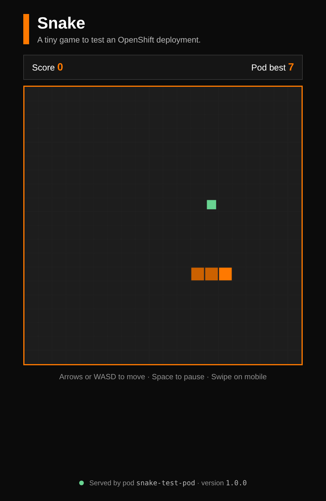

# snake-openshift


A tiny Snake game served by a small Python web server, made to test the deployment of an app on Red Hat OpenShift. It has no dependencies, starts in less than a second, and shows which pod answered your request, so you can see builds, scaling, load balancing and rolling updates happen live.

## ✨ Features

- **Snake Game**: Classic snake gameplay in the browser (arrows, WASD/ZQSD, swipe on mobile, Space to pause).
- **Pod Name Display**: The page footer shows the pod that served it, and the version of the app.
- **Health Checks**: `/healthz` and `/readyz` endpoints for the OpenShift liveness and readiness probes.
- **Best Score per Pod**: Each pod keeps its own best score in memory, a simple way to see that several replicas exist.
- **OpenShift Ready**: Listens on port 8080, runs as a random non-root user, and stops cleanly on `SIGTERM`.

## 📋 Requirements

- **Python 3.x**: To run the server on your computer. You can download it from the [official website](https://www.python.org/).
- **An OpenShift cluster**: Your company cluster, or the free [Red Hat Developer Sandbox](https://developers.redhat.com/developer-sandbox).
- **oc CLI** (optional): The OpenShift command-line tool, available from the `?` menu of the OpenShift web console.

## 🛠️ Installation

1. **Clone this repository**:
    ```bash
    git clone https://github.com/darrengls/snake-openshift
    cd snake-openshift
    ```

2. **Run the server** (no library to install):
    ```bash
    python app.py
    ```

3. **Open the game** at [http://localhost:8080](http://localhost:8080).

## 🚀 Deploy on OpenShift

### Option 1: Web console (easiest)

1. In the **Developer** view, click **+Add** → **Import from Git**.
2. Paste the repository URL: `https://github.com/darrengls/snake-openshift`
3. For the build, choose **Builder Image** → **Python**.
4. Leave **Target port** on `8080`, keep **Create a route** checked, and click **Create**.
5. When the build is done, click the arrow icon on the app in the **Topology** view to open the game.

### Option 2: oc CLI with the YAML file

1. **Log in and create a project**:
    ```bash
    oc login --token=<your-token> --server=<your-cluster-api>
    oc new-project snake-test
    ```

2. **Create everything** (image stream, build, deployment, service and route):
    ```bash
    oc apply -f openshift/snake.yaml
    ```

3. **Follow the build**:
    ```bash
    oc logs -f bc/snake
    ```

4. **Get the URL of the game**:
    ```bash
    oc get route snake
    ```

## 🧪 Deployment Tests

1. **Scaling**: Add pods, then refresh the page several times: the pod name in the footer changes.
    ```bash
    oc scale deployment/snake --replicas=3
    ```

2. **Rolling update**: Change the version and watch the new pods replace the old ones, with no downtime.
    ```bash
    oc set env deployment/snake APP_VERSION=1.1.0
    oc rollout status deployment/snake
    ```

3. **Self-healing**: Delete a pod, and OpenShift starts a new one right away.
    ```bash
    oc delete pod -l app=snake --wait=false
    oc get pods -w
    ```

4. **Logs**: See the requests received by the pods.
    ```bash
    oc logs -f deployment/snake
    ```

5. **Clean up**: Remove everything when you are done.
    ```bash
    oc delete all,imagestream,buildconfig,route -l app=snake
    ```

## 📂 Project Structure

- `app.py`: The Python web server (game, health checks and API).
- `static/index.html`: The Snake game (HTML, CSS and JavaScript in one file).
- `Containerfile`: Builds the container image from the Red Hat UBI Python image.
- `openshift/snake.yaml`: Everything OpenShift needs: build, deployment, service and route.
- `requirements.txt`: Empty on purpose, it lets OpenShift detect a Python project.
- `README.md`: Instructions and documentation for the project.

## 📖 How It Works

1. **Build**: OpenShift pulls the code from GitHub and builds a container image from the `Containerfile` (or with the Python builder image in option 1).
2. **Deployment**: Two pods run the server. OpenShift only sends traffic to a pod once `/readyz` answers, and restarts it if `/healthz` stops answering.
3. **Service and Route**: The service balances requests between the pods, and the route gives the game a public HTTPS address.
4. **API**: The game calls `/api/info` to display the pod name, and `/api/score` to save the best score on the pod that answered.

## ⚡ Technologies Used

- **Python**: The programming language used for the server (standard library only).
- **HTML5 Canvas and JavaScript**: Used to draw and run the game in the browser.
- **Red Hat UBI**: The Universal Base Image used to build the container.
- **Red Hat OpenShift**: The Kubernetes platform used to build, deploy and scale the app.

## 📸 Screenshot



## 🔗 License

This project is open-source and available under the MIT License. Feel free to fork, modify, and use it in your projects.

---

Enjoy the game, and have fun breaking and scaling your pods!
